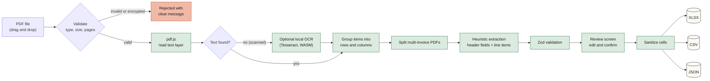
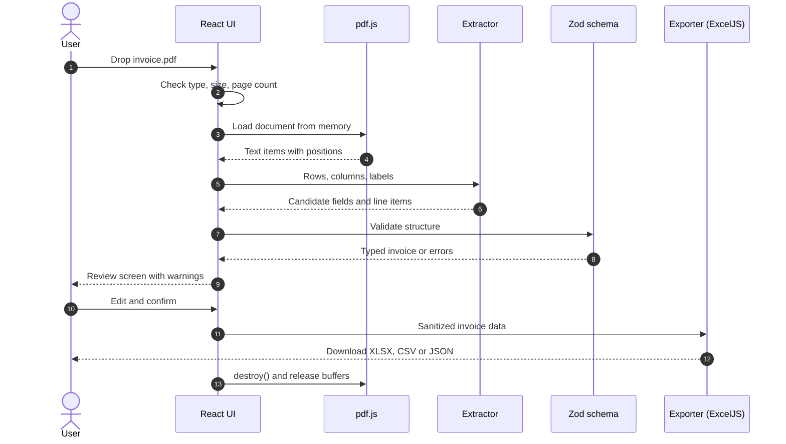
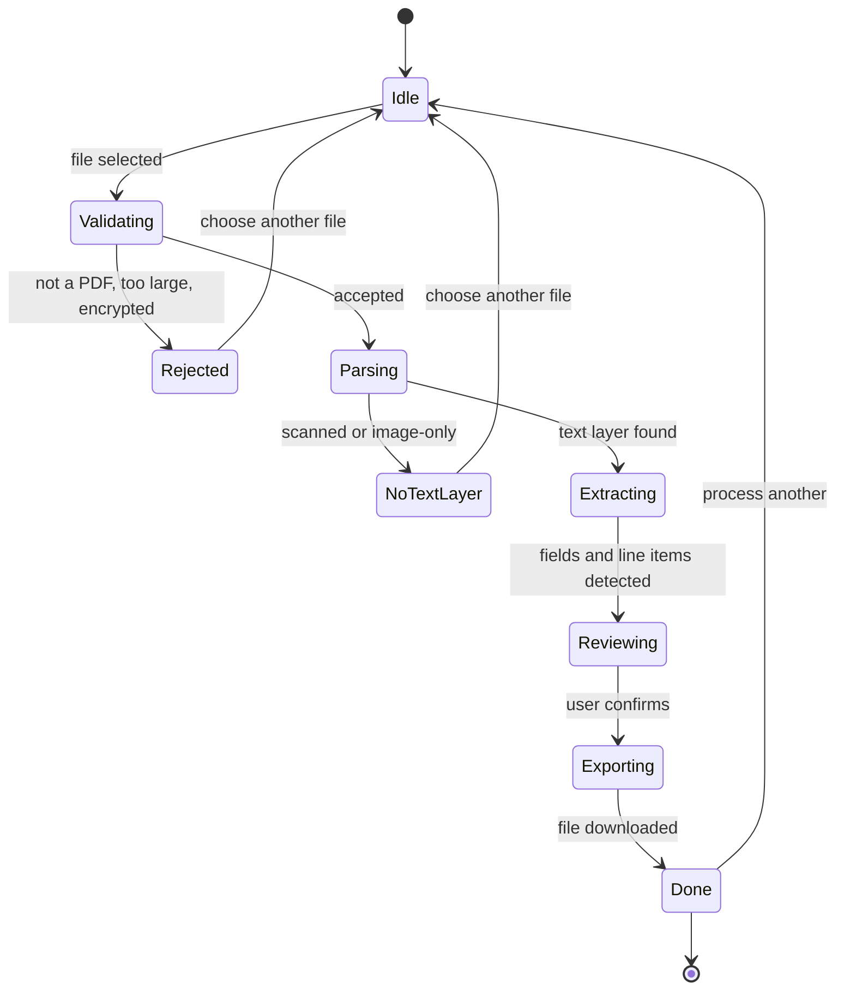
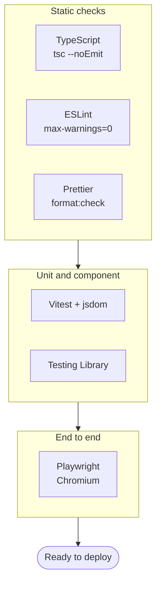
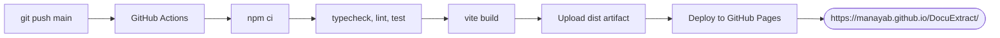
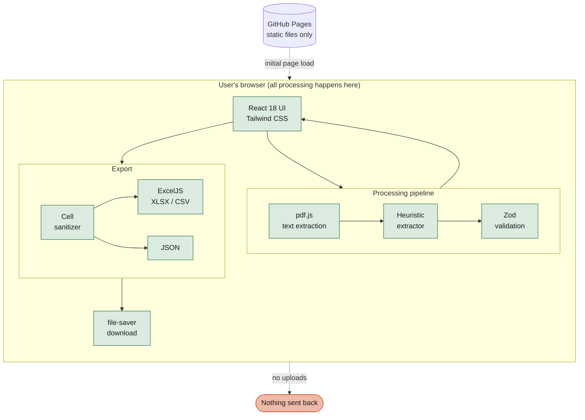
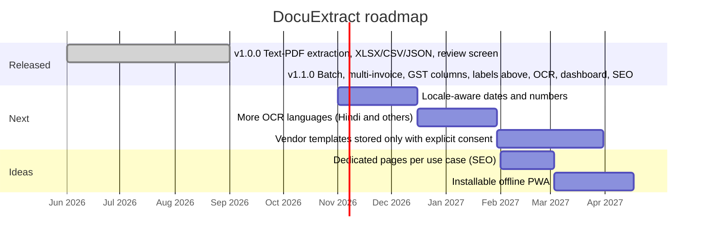

<div align="center">



# DocuExtract

**Turn invoice PDFs into clean XLSX, CSV and JSON. Entirely in your browser.**

No backend. No account. No database. No analytics. No telemetry.

[](https://github.com/MANayab/DocuExtract/actions)
[](LICENSE)
[](CHANGELOG.md)
[](package.json)
[](tsconfig.json)
[](package.json)
[](PRIVACY.md)

[**Live app**](https://manayab.github.io/DocuExtract/) &nbsp;·&nbsp; [Report a bug](https://github.com/MANayab/DocuExtract/issues) &nbsp;·&nbsp; [Request a feature](https://github.com/MANayab/DocuExtract/issues) &nbsp;·&nbsp; [Changelog](CHANGELOG.md)

</div>

---

## Table of contents

- [Why DocuExtract](#why-docuextract)
- [Features](#features)
- [How it works](#how-it-works)
- [Support matrix](#support-matrix)
- [Known limitations](#known-limitations-v110)
- [OCR for scanned PDFs](#ocr-for-scanned-pdfs-optional)
- [Search and AI discoverability](#search-and-ai-discoverability)
- [Quick start](#quick-start)
- [Scripts](#scripts)
- [Testing](#testing)
- [Deployment](#deployment)
- [Architecture](#architecture)
- [Privacy and security](#privacy-and-security)
- [Roadmap](#roadmap)
- [Tech stack](#tech-stack)
- [Contributing](#contributing)
- [License](#license)

---

## Why DocuExtract

Most invoice tools ask you to upload financial documents to a server you do not control. DocuExtract takes the opposite approach: the PDF is opened, read and converted **inside your browser tab**. The application code never sends your file anywhere, and there is nothing to sign up for.

> [!IMPORTANT]
> Extraction is **heuristic**. Always review the output before using it for accounting, tax, payment, or legal records. DocuExtract shows a review screen for exactly this reason.

## Features

| | |
|---|---|
| **Local-only processing** | PDFs are parsed in the browser with pdf.js. No upload, no server round trip. |
| **Batch dashboard** | Drop up to 50 PDFs at once. Live queue, KPI cards, per-invoice status (Validated, Review, Failed, Scanned) and duplicate detection. |
| **Multi-invoice PDFs** | A PDF that holds several invoices is split automatically; multi-page invoices stay together. |
| **GST-aware** | GSTIN per party, CGST / SGST / IGST, and per-line HSN, taxable value, tax rate and tax amount columns. |
| **Labels above values** | Reads layouts where "Invoice No." sits above its value, not just `Label: value` lines. |
| **Optional local OCR** | Scanned PDFs can be read with Tesseract running in your browser, from files served by this site (no CDN). Always marked lower confidence. |
| **Combined exports** | One Excel workbook (one row per invoice plus line items, parties, taxes, validation, metadata), CSV for invoices or line items, JSON. |
| **Review before export** | Edit every field and line item; confidence bands highlight what to check; checks re-run as you type. |
| **Locale-aware dates and numbers** | Select India (en-IN), United States (en-US), United Kingdom (en-GB), or Germany (de-DE). Numeric dates and separator interpretation depend on the selected locale; ambiguous values require review. |
| **Safe spreadsheets** | Every cell is sanitized against formula injection; CSV has a UTF-8 BOM so Excel shows ₹ correctly. |
| **No persistence** | Invoice data is never written to URLs, `localStorage` or `sessionStorage`. Memory is released after each file. |
| **SEO and AI-ready** | Structured data, pre-rendered content, sitemap, `llms.txt`; see [docs/SEO.md](docs/SEO.md). |
| **Tested** | Unit, integration and end-to-end tests; type checking and linting in CI. |

## Locale-aware parsing

The locale selector controls date order and number separators; it does not infer or change invoice currency. Numeric dates whose day and month are both 12 or less are flagged as ambiguous even when a locale-specific interpretation is displayed. Review extracted financial data before relying on it.

| Locale | Numeric date order | Decimal separator | Grouping separator | Ambiguity handling |
|---|---|---|---|---|
| India (en-IN) | DD/MM/YYYY | `.` | `,` (Indian grouping, e.g. `1,23,456.78`) | Plausible day/month pairs are interpreted as DD/MM and flagged. |
| United States (en-US) | MM/DD/YYYY | `.` | `,` (western grouping, e.g. `123,456.78`) | Plausible day/month pairs are interpreted as MM/DD and flagged. |
| United Kingdom (en-GB) | DD/MM/YYYY | `.` | `,` (western grouping) | Plausible day/month pairs are interpreted as DD/MM and flagged. |
| Germany (de-DE) | DD/MM/YYYY | `,` | `.` (western grouping, e.g. `123.456,78`) | Plausible day/month pairs are interpreted as DD/MM and flagged. |

## How it works



### Request lifecycle

Everything below happens on the user's device. The only network traffic is the initial load of the static site.



### Processing states



## Support matrix

| PDF type | Support |
| --- | --- |
| Text-based | **Yes.** Reliably supported. |
| Scanned PDF | **Optional.** Local OCR when the build bundles it ([docs/OCR.md](docs/OCR.md)); otherwise listed as "Scanned PDF". Always lower confidence. |
| Image-only | **Optional.** Same as scanned PDFs. |
| Password-protected | **Limited.** Encrypted files are rejected unless provided as an already-decrypted PDF. |
| Corrupt | No. |
| Handwritten | Not guaranteed. |
| Multi-page | **Yes**, up to 100 pages. |
| Multiple invoices per PDF | **Yes.** Split by invoice number change; multi-page invoices stay together. |

## Known limitations (v1.1.0)

- **OCR is English only**, limited to 20 pages per PDF, and slower and less accurate than text PDFs. Every OCR'd invoice is marked **Review**.
- OCR needs a one-time build step to bundle the Tesseract files ([docs/OCR.md](docs/OCR.md)). Without it, scanned PDFs are detected but not read.
- Multi-invoice splitting relies on the invoice number changing between pages. A PDF where invoices share a number, or print none, is read as one invoice.
- Line items need visible column gaps and a header row. Tables without a header, or with wrapped two-line headers, may need manual correction on the review screen.
- Numeric dates such as `05/09/2026` are read as **DD/MM/YYYY**; check the highlighted field when your invoices use MM/DD.
- Extraction is heuristic. Always review before using values for accounting or tax.

## Quick start

**Requirements:** Node.js 20 or newer.

```bash
git clone https://github.com/MANayab/DocuExtract.git
cd DocuExtract
npm ci
npm run dev
```

Open the URL Vite prints. Because the app is built for GitHub Pages, the path includes `/DocuExtract/`.

Try the files in [`samples/`](samples/) (text, GST table, label-above, multi-invoice and a scan).

To preview a production build:

```bash
npm run build
npm run preview
```

## Scripts

| Command | What it does |
| --- | --- |
| `npm run dev` | Start the Vite dev server with hot reload (runs `prepare:ocr` first). |
| `npm run prepare:ocr` | Copy the Tesseract worker, WASM core and language data into `public/ocr/` (also runs before `dev` and `build`). |
| `npm run build` | Produce a production build in `dist/`. |
| `npm run preview` | Serve the production build locally. |
| `npm run typecheck` | Run `tsc --noEmit`. |
| `npm run lint` | Run ESLint with zero warnings allowed. |
| `npm run format:check` | Check formatting with Prettier. |
| `npm run test` | Run unit and component tests once (Vitest). |
| `npm run test:watch` | Run Vitest in watch mode. |
| `npm run test:e2e` | Run Playwright end-to-end tests. |

## Testing

```bash
# static checks
npm run typecheck
npm run lint
npm run format:check

# unit and component tests
npm run test

# end-to-end (first time only: install a browser)
npx playwright install chromium
npm run test:e2e
```



## Deployment

The Vite `base` path is `/DocuExtract/`. In the repository settings, set **Pages → Source** to **GitHub Actions**. Every push to `main` runs `.github/workflows/deploy.yml`, which builds the app and publishes the `dist` directory.



> [!NOTE]
> If you fork the project under a different repository name, change `base` in `vite.config.ts` to match.

## OCR for scanned PDFs (optional)

OCR runs entirely in the browser from files served by your own site. Enable it once:

```bash
npm install --save-exact '@tesseract.js-data/eng'
npm run build
```

Full guide, limits and troubleshooting: [docs/OCR.md](docs/OCR.md).

## Search and AI discoverability

The page ships title and description tags, canonical URL, Open Graph and Twitter cards, JSON-LD (`WebSite`, `WebApplication`, `FAQPage`), pre-rendered semantic HTML for crawlers that do not run JavaScript, a sitemap, `robots.txt` and `llms.txt`. Step-by-step Google Search Console indexing and honest caveats: [docs/SEO.md](docs/SEO.md).

## Architecture

DocuExtract is a static single-page app. There is no server component, so there is no server-side attack surface and nothing to operate.



### Design principles

1. **Local first.** If a feature would need a server, it does not ship.
2. **Never trust extracted text.** Everything read from a PDF is validated and sanitized before it is displayed or exported.
3. **Say when unsure.** Ambiguous values are flagged on the review screen instead of silently guessed.
4. **Release memory.** Documents and buffers are destroyed once processing completes.

## Privacy and security

Files are processed locally by this application and are not uploaded by application code. Verify your own browser network activity (DevTools → Network) if your environment requires independent confirmation. See [PRIVACY.md](PRIVACY.md).

| Area | Behaviour |
| --- | --- |
| Network | No upload of invoice data. No analytics or telemetry. |
| Storage | Invoice data is not written to URLs, `localStorage` or `sessionStorage`. |
| Memory | PDF buffers are released and PDF documents are destroyed after processing. |
| Spreadsheet exports | Cells that could trigger formulas are sanitized (CSV and formula injection). |
| Rendering | React rendering does not use `dangerouslySetInnerHTML`. |

To report a vulnerability, follow [SECURITY.md](SECURITY.md). Please do not open a public issue for security problems.

## Roadmap



> [!NOTE]
> Dates are indicative, not commitments. Track real progress in [Issues](https://github.com/MANayab/DocuExtract/issues).

## Tech stack

| Layer | Tools |
| --- | --- |
| UI | React 18.3, hand-written CSS design system (Tailwind CSS 3.4 in the toolchain) |
| Language and build | TypeScript 5.6, Vite 5.4 |
| PDF parsing | pdfjs-dist 4.10 |
| OCR (optional, bundled locally) | tesseract.js 5.1 + tesseract.js-core |
| Validation | Zod 3.23 |
| Export | ExcelJS 4.4, file-saver 2.0 |
| Quality | ESLint 9, Prettier 3, Vitest 2, Testing Library, Playwright 1.48 |
| Hosting | GitHub Pages via GitHub Actions |

## Contributing

Contributions are welcome. Please read [CONTRIBUTING.md](CONTRIBUTING.md) and the [Code of Conduct](CODE_OF_CONDUCT.md) first.

```bash
git checkout -b feat/my-change
npm ci
npm run typecheck && npm run lint && npm run test
git commit -m "feat: describe your change"
git push origin feat/my-change
```

Then open a pull request. Sample invoices that fail to extract (with sensitive data removed) are the most useful bug reports.

## License

Released under the [MIT License](LICENSE). See also [TERMS.md](TERMS.md) and [PRIVACY.md](PRIVACY.md).

<div align="center">

Built by [@MANayab](https://github.com/MANayab)

</div>
